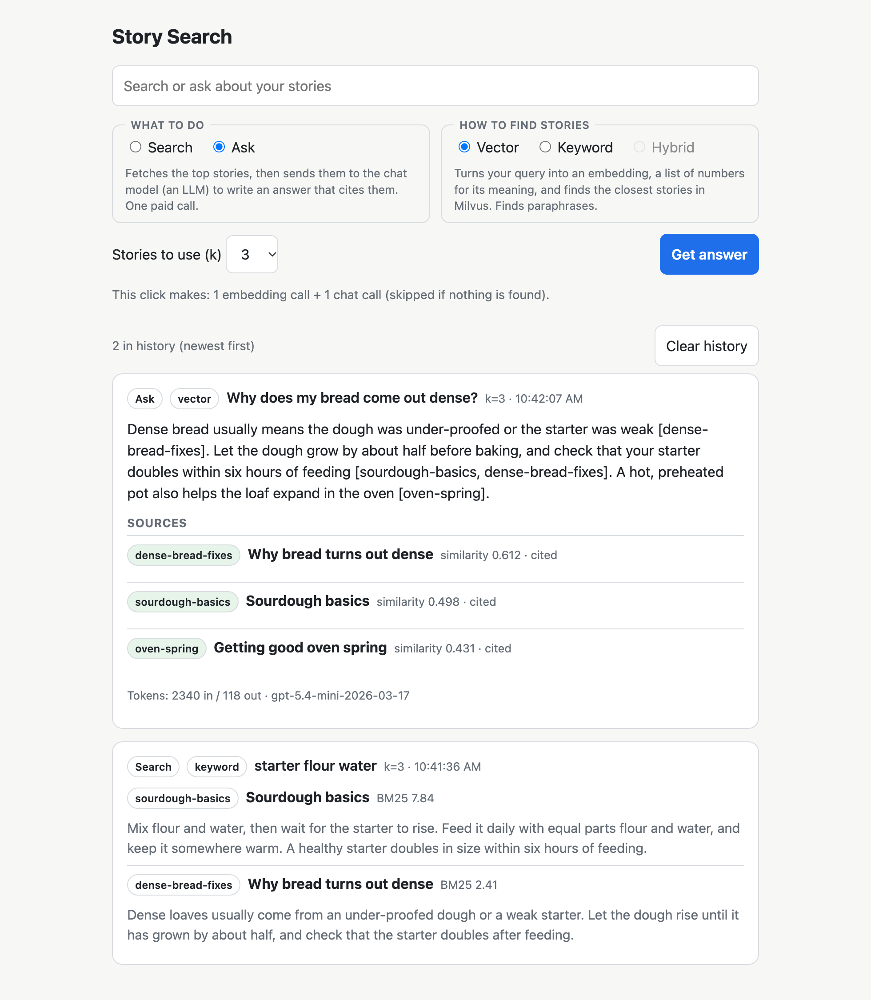

# story-search

A local learning project: semantic search and retrieval-augmented generation (RAG) over a private collection of documents, using Milvus (vector database) and OpenAI. Optional keyword search with Elasticsearch and hybrid search (both fused with reciprocal rank fusion) are built in.

It works with any content you can split into **stories**: self-contained pieces small enough to embed as one chunk, such as articles, notes, FAQ entries, Q&As or case studies. Point it at a folder of `.pdf`, `.txt` or `.md` files and configure a few environment variables.

- **Search:** type a query, get the closest stories with scores, found by meaning (vector) or by the words you typed (keyword).
- **Ask:** type a question, get an answer written only from the top stories, with the stories it cited.

Everything runs locally on a Mac. Your documents stay outside this repo.



*The web page, shown with made-up sample stories: an Ask answer using hybrid search (each source shows its RRF score and its rank in each search), and a keyword search with BM25 scores.*

## Docs

| File | What it covers |
|---|---|
| [spec.md](spec.md) | What is built: scope, data model, API, guardrails, milestones, decisions |
| [SETUP.md](SETUP.md) | One-time setup: Docker, Milvus, `.env`, OpenAI project and key, story folder |
| [CLAUDE.md](CLAUDE.md) | Working rules for Claude Code in this repo |

## Quick start

1. Do the one-time setup in [SETUP.md](SETUP.md): Docker Desktop, a restricted OpenAI key, and a private folder for your documents. Create `.env` from `.env.example` and set at least `OPENAI_API_KEY`, `STORIES_DIR` and `CHAT_MODEL`.
2. Install and start Milvus:
   ```bash
   npm install
   npm run dev:up          # starts Docker Desktop + Milvus, waits until healthy
   npm run check:milvus    # prints the Milvus server version
   ```
3. Load your documents:
   ```bash
   npm run ingest:dry      # parse and chunk only; no OpenAI or Milvus calls
   npm run ingest          # embed new/changed stories and store them in Milvus
   ```
4. Start the app and open <http://127.0.0.1:3000>:
   ```bash
   npm run api
   ```
5. Stop when done: `npm run dev:down` (data is kept).

## Your content

Put `.pdf`, `.txt` and `.md` files anywhere under `STORIES_DIR`. Two layouts work, and you can mix them:

- **One story per file** (the default): the first line of the file is the story's title.
- **Several stories per file:** set `STORY_HEADER_PATTERN` in `.env` to a regular expression that matches the line starting each story, for example `'^## (?<title>.+)$'` for markdown headings. Add `(?<id>...)` to the pattern to use your own ids. `STORY_BODY_START_PATTERN` is only needed when titles can wrap over several lines.

To hide weak matches, set `MIN_SCORE` in `.env` (a number between -1 and 1; unset means no filtering). Search then returns nothing for an unrelated query, and Ask skips the paid chat call. `npm run eval` prints the score gap between your weakest correct match and the strongest negative case to help choose a value. A plausible-sounding question that your stories don't answer can still score high; the chat model handles that case.

Ids are made from titles unless your pattern captures one. Run `npm run ingest:dry` first: it lists the stories it found (ids, titles, word counts) without calling any API. Details are in [SETUP.md](SETUP.md) and [spec.md](spec.md) §3.

## Search methods
Every search and ask takes a `mode`:

| Mode | Finds stories by | Needs |
|---|---|---|
| `vector` (default) | meaning, using embeddings stored in Milvus | Milvus and OpenAI embeddings |
| `keyword` | the words in your query (BM25), with English word-form matching by default | Elasticsearch (`ELASTICSEARCH_URL` in `.env`) |
| `hybrid` | both at once, with their rankings merged by reciprocal rank fusion (RRF) | everything vector and keyword need |

Keyword search makes no OpenAI call, and vector search is better at paraphrases. Keyword is better at exact terms like acronyms and product names. Hybrid runs both and merges their rankings, so a story both methods like rises above one that only a single method ranked first. The merge is plain code, not an LLM, and hybrid costs the same as vector. The web page has a Vector / Keyword / Hybrid control that is disabled for modes that aren't set up. Turn keyword search on with `ELASTICSEARCH_URL`, then run `npm run ingest`; no re-embedding is needed. Set `SEARCH_MODE` to change the default. See [SETUP.md](SETUP.md) for the container and the analyzer setting.

## Commands

| Command | What it does |
|---|---|
| `npm run dev:up` / `dev:down` | Start / stop Docker Desktop, Milvus and Elasticsearch |
| `npm run check:milvus` | Connect to Milvus and print its version |
| `npm run ingest:dry` | Parse and chunk the files; prints story ids, titles and word counts |
| `npm run ingest -- [--rebuild] [--batch-size N]` | Embed new or changed stories into Milvus, and index all stories into Elasticsearch if enabled; `--rebuild` drops the collection (and the index) first |
| `npm run api` | Fastify server plus the web page, on 127.0.0.1:3000 |
| `npm run eval -- [--mode vector\|keyword\|hybrid] [--via http] [--no-cache]` | Search eval: is the expected story in the top 3? `--mode` picks the method, `--via http` runs it against the server |
| `npm run eval -- --compare [--pool N]` | Runs vector, keyword and hybrid side by side and prints where each ranks the expected story, with top-3 counts and MRR. No OpenAI cost. `--pool` sets the hybrid candidate pool |
| `npm run eval -- --ask` | Answer eval: does each answer cite the expected story? **Makes paid chat calls** |

Ingest re-embeds only stories whose `content_hash` changed, so rerunning it is cheap. The evals read `questions.json` from `STORIES_DIR` (format in [spec.md](spec.md) §7).

## API

| Endpoint | Purpose |
|---|---|
| `GET /search?q=...&k=3&mode=vector` | Ranked stories with title, snippet and score |
| `POST /ask` `{question, k, mode}` | Answer, cited story ids, sources, token usage |
| `GET /` | The web page |
| `GET /health` | Liveness check, plus which modes are available |

`k` defaults to 3 (allowed 1–10); the question is limited to 500 characters. Details are in [spec.md](spec.md) §6.

## Activity log

The server and ingest append one JSON line per event to `logs/activity.log` (git-ignored; set `LOG_FILE` in `.env` to move it): for each request the route, mode, status, total milliseconds, milliseconds per stage (embed, vector, keyword, fuse, chat), result counts and token counts. It never records query, question or story text, only their lengths. Watch it live with `tail -f logs/activity.log`. See [spec.md](spec.md) §8.

## Cost

Embedding is cheap: a collection of about 17 stories of ~700 words costs about $0.0003. A vector search is almost free (one small embedding), and a keyword search makes no OpenAI call at all. An ask costs about $0.0035 with `gpt-5.4-mini`: one embedding plus one chat call. Token usage is logged for every call, prompts and output are capped, and nothing is retried automatically. See [spec.md](spec.md) §8.

## Layout

```
packages/api/    Fastify backend: ingest, embeddings, Milvus search, RAG, routes
packages/web/    the single-page web UI (served by the API)
packages/eval/   search and answer evaluation against a question set
scripts/         dev-up.sh / dev-down.sh
```

The full tree is in [spec.md](spec.md) §10.

## Privacy

- Your documents and eval questions live in `STORIES_DIR`, outside the repo; their text is never copied into the repo, tests or logs.
- Files generated from your documents (such as the eval embedding cache) go in `STORIES_DIR/.story-search/`.
- `.env` (API key, paths, patterns) is git-ignored. The browser never sees the key; it only talks to the local server.
- Keep Milvus and Elasticsearch data out of iCloud-synced folders: set `DOCKER_VOLUME_DIRECTORY` as described in [SETUP.md](SETUP.md) §5. Elasticsearch runs without security, so its port is bound to localhost only.

## Status

Milestones 1–8 are done: setup, ingest, search with eval, ask, the web page, Elasticsearch keyword search with a per-request search mode, hybrid search with reciprocal rank fusion, and an activity log. On the first test set (17 stories, 10 questions), hybrid matches vector-only and beats keyword-only on ranking quality, and all three find the right story in the top 3 every time. That set is too small to show hybrid's advantage on exact-term queries; [spec.md](spec.md) §7 has the comparison and its limits.
